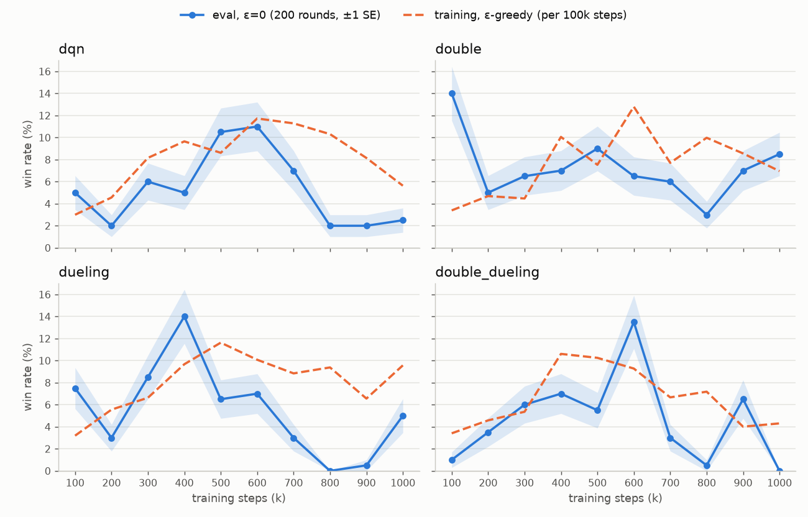
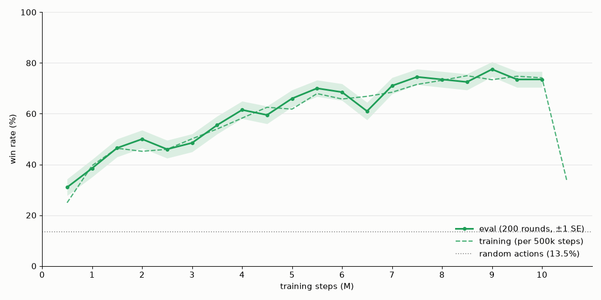
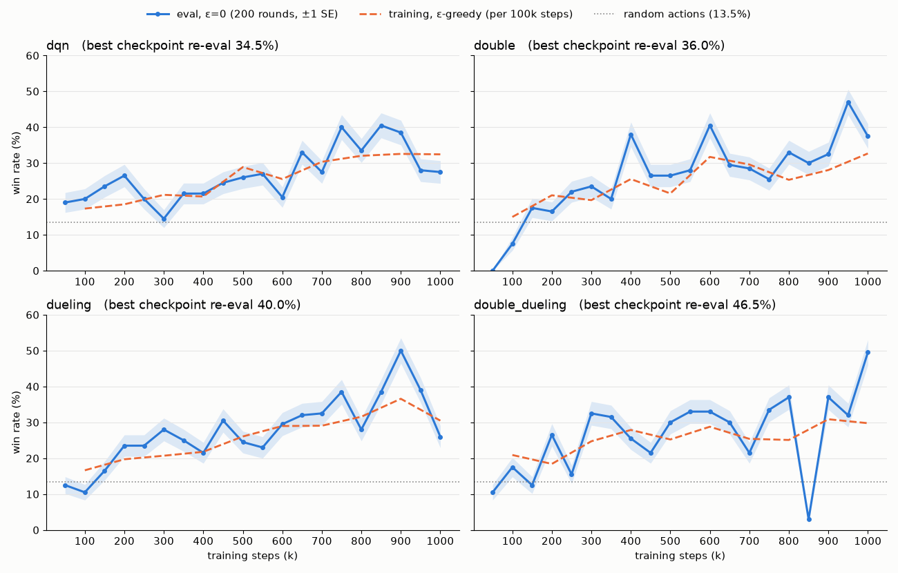

# DQN 4종 체크포인트 평가 (2026-10-08)

> 시간 순서로 쌓은 기록이다. 지금 환경(필살기 포함 행동 20가지)의 결과는 아래쪽 "DQN + 필살기"부터 있다. 그 위의 절은 모두 이전 환경(컬러 상태, DQN은 행동 17가지, PPO는 `MultiBinary(12)`) 기준이다.

학습 로그를 보면 마지막 200판 승률이 dueling 8.5%, double 8.0%, dqn 7.5%, double_dueling 2.0%였다.
기법을 더할수록 오히려 나빠진 것처럼 보여서, 무작위 행동을 빼고 체크포인트마다 다시 재 보았다.

## 무엇을 했나

- 대상: `runs/{dqn,double,dueling,double_dueling}`의 `qnet_100000.pt` ~ `qnet_1000000.pt`, 모두 40개.
  네 학습 모두 하이퍼파라미터가 같고(100만 걸음, γ=0.94, lr 1e-4, 버퍼 10만, 동기화 1만 걸음), 시드는 하나씩이다.
- 방법: 체크포인트마다 200판, ε=0(무작위 행동 없음).
  에뮬레이터와 정책이 모두 결정적이라 그냥 돌리면 200판이 같은 판이 된다.
  그래서 판마다 처음 0~30걸음은 무작위 행동을 하게 했고, 체크포인트마다 서로 다른 결과가 165~170가지 나왔다.
- 실행: GPU 서버 6번 GPU, 프로세스 60개로 약 10분.

```bash
uv run python sf2/evaluate.py runs/dqn runs/double runs/dueling runs/double_dueling \
    --episodes 200 --workers 60 --device cuda --out runs/eval.csv
```

## 결과



파란 선이 평가 승률(띠는 ±1 표준오차, 약 ±2%p)이고, 주황 점선은 학습 중 ε-탐욕 승률을 10만 걸음 구간마다 평균한 값이다.
학습 초반(30만 걸음까지)은 ε이 커서 무작위 행동이 많다.

| 승률(%) | 10만~30만 | 40만~60만 | 70만~100만 | 가장 좋은 체크포인트 |
|:--|--:|--:|--:|:--|
| dqn | 4.3 | 8.8 | 3.4 | 60만 걸음, 11.0 |
| double | 8.5 | 7.5 | 6.1 | 10만 걸음, 14.0 |
| dueling | 6.3 | 9.2 | 2.1 | 40만 걸음, 14.0 |
| double_dueling | 3.5 | 8.7 | 2.5 | 60만 걸음, 13.5 |

## 읽은 것

**기법 사이의 순위는 이 데이터로 정할 수 없다.** 40만~60만 걸음 구간 승률은 7.5~9.2%로 네 학습이 거의 같다.
가장 좋은 체크포인트도 11~14%로 비슷하다. 40개 가운데 가장 큰 값을 고르면 운으로도 표준오차 두 배쯤은 위로 나온다.
그러니 double 10만 걸음의 14%(ε이 아직 0.7일 때 저장한 모델)도 진짜 실력이라기보다 운일 가능성이 크다.
학습 로그에서 double_dueling만 낮았던 2.0%는 마지막 구간의 흔들림이 겹친 결과로 보인다.

**네 학습 모두 40만~60만 걸음에서 가장 좋고, 그 뒤로 나빠진다.** 기법과 상관없이 같은 모양이다.
그래서 "기법을 더해서 나빠졌다"가 아니라 "이 설정으로 오래 학습하면 나빠진다"가 맞는 설명이다.
ε은 30만 걸음에 0.05까지 내려가 그대로 머문다. 이후로는 버퍼(10만 걸음)에 거의 자기 정책이 만든 경험만 쌓인다.

**바로 옆 체크포인트끼리도 차이가 크다.** dueling은 40만 걸음 14% → 50만 걸음 6.5%, double_dueling은 60만 걸음 13.5% → 70만 걸음 3%이다.
표준오차(약 2%p)보다 훨씬 크게 움직이므로, 정책 자체가 10만 걸음 사이에도 크게 바뀐다는 뜻이다.
"마지막 체크포인트 = 가장 좋은 모델"이 아니다.

**학습 후반에는 무작위 행동 5%가 오히려 도움이 된다.** 70만~100만 걸음 구간에서 평가 승률(ε=0)은 2~6%이고,
같은 구간 학습 승률(ε=0.05)은 4~11%로 대체로 더 높다. 보상도 비슷한 차이를 보인다.
학습 중 보상은 0.15 안팎으로 유지되지만, ε=0 평가에서는 dueling·double_dueling의 판당 보상이
60만 걸음 0.09~0.15에서 100만 걸음 −0.04까지 떨어진다.
탐욕 정책이 같은 행동을 반복하는 패턴에 빠지고 상대 CPU가 그것을 받아치는데, 가끔 섞이는 무작위 행동이 그 반복을 끊어 주는 것으로 보인다.
행동 분포는 기록하지 않았으므로 아직 가설이다.

이전에 "보상(준 피해 위주)과 승리가 어긋나서"라고 설명했는데, ε=0 평가에서는 보상도 같이 떨어졌다.
그러니 그 어긋남만으로는 후반 하락을 설명하지 못한다.
γ=0.94로는 앞을 약 17걸음만 내다보므로 승패 보상이 거의 반영되지 않는다는 점은 여전히 사실이지만, 주원인이라고 하기는 어렵다.

## 다음에 해볼 것

1. 평가할 때 행동 분포를 기록한다. 후반 체크포인트가 특정 행동 몇 개만 반복하는지 확인한다.
2. 같은 체크포인트를 ε=0.05로도 평가해 ε=0과 비교한다. 무작위 행동이 승률을 올리는지 직접 확인한다.
3. 학습 중 5만~10만 걸음마다 ε=0 평가를 돌려 가장 좋은 모델을 따로 저장한다(`qnet_best.pt`).
4. 기법을 비교하려면 시드를 3개 이상 돌린다. 시드 하나로는 지금처럼 흔들림이 차이를 덮는다.
5. 후반 붕괴를 줄일 후보로는 lr 낮추기(1e-4 → 5e-5), 목표 신경망 동기화 늘리기(1만 → 3만 걸음), γ 올리기(0.94 → 0.99)를 하나씩 바꿔 본다.

원자료는 `runs/eval.csv`(체크포인트 × 판 8,000줄)이고, `runs/`는 git에 올리지 않는다.

## 추가 실험: 학습률 줄이기와 가장 좋은 모델 저장 (2026-10-08 오후)

`--lr-end 1e-5 --eval-interval 50000`으로 네 학습을 다시 돌렸다(`runs/*_lrdecay`).
학습률은 1e-4에서 1e-5까지 직선으로 줄였고, 나머지 설정은 위 실험과 같다.
체크포인트 80개(5만 걸음 간격)를 위와 같은 방식(200판, ε=0, 처음 0~30걸음 무작위)으로 다시 평가했다.

| 승률(%) | 40만~60만 (이전 → 이번) | 70만~100만 (이전 → 이번) | 100만 걸음 모델 (이전 → 이번) |
|:--|--:|--:|--:|
| dqn | 8.8 → 7.7 | 3.4 → 8.4 | 2.5 → 7.5 |
| double | 7.5 → 7.0 | 6.1 → 9.8 | 8.5 → 8.5 |
| dueling | 9.2 → 7.8 | 2.1 → 13.1 | 5.0 → 16.5 |
| double_dueling | 8.7 → 10.6 | 2.5 → 15.6 | 0.0 → 17.0 |

**후반 하락이 사라졌다.** 40만~60만 걸음 구간은 이전과 비슷하지만, 70만 걸음 이후에 떨어지지 않고 오히려 오른다.
Dueling을 쓴 두 학습에서 효과가 가장 커서, 70만~100만 걸음 평균이 2%대에서 13~16%가 되었다.
이번에는 마지막 모델이 가장 좋은 축에 든다. 앞에서 본 하락은 학습률이 후반까지 커서 정책이 흔들린 탓이 컸다는 뜻이다.

**학습 중 평가로 고른 `qnet_best.pt`는 믿기 어렵다.** 학습 중에는 100판·ε=0.05로 20번 평가해 가장 높은 것을 골랐다.
그런데 고른 체크포인트를 200판·ε=0으로 다시 재면 3.5~13.5%로, 학습 중에 잰 15~23%보다 낮다.
100판은 표준오차가 3~4%p라 20번 중 가장 높은 값은 운으로 부풀기 쉽다. 고를 때는 판 수를 늘리거나 가까운 체크포인트 몇 개를 평균해야 한다.

**Adam eps 1.5e-4는 쓰면 안 된다.** 처음에는 Rainbow를 따라 eps도 1.5e-4로 바꿨는데, 40만 걸음까지 네 학습 모두 거의 배우지 못했다.
보상에 0.001을 곱하는 이 환경은 그래디언트 크기가 1e-6 수준이라 eps가 분모를 차지해 학습 폭이 약 1/100로 줄었다.
이 학습은 40만 걸음에서 멈췄고 기록은 서버 `runs/*_stable_adameps`에 있다.

다음 후보는 n-step 수익과 γ 올리기(리서치 3번)다. 지금도 100만 걸음에서 오르는 중이므로 200만 걸음까지 늘려 보는 것도 같이 볼 만하다.

## 행동 분포 (2026-10-08 저녁)

100만 걸음 모델 8개를 200판씩(ε=0) 돌려, 모델이 고른 행동을 셌다(`runs/eval_actions_actions.csv`).
기준으로 완전 무작위 행동도 200판 돌렸다(승률 2.0%, 진 판에서 바이슨에게 남은 체력 107/176).

| 모델 | 승률 | 직전과 같은 행동 | 가장 많이 고른 행동 |
|:--|--:|--:|:--|
| dueling (학습률 고정) | 4.0% | 87% | ↓+C 다리 걸기 92% |
| double_dueling (학습률 고정) | 1.0% | 84% | B 중킥 89% |
| dqn (학습률 고정) | 0.5% | 33% | A 약킥 26%, C 강킥 22% |
| double (학습률 고정) | 6.5% | 35% | ↗ 점프 29%, ↖ 점프 19% |
| dueling_lrdecay | 15.5% | 35% | ↗ 점프 40%, C 강킥 26% |
| double_dueling_lrdecay | 15.0% | 17% | 고르게 퍼짐(가장 많은 것이 ↑ 13%) |
| double_lrdecay | 14.0% | 16% | 고르게 퍼짐(가장 많은 것이 ↘ 9%) |
| dqn_lrdecay | 8.5% | 14% | 고르게 퍼짐(가장 많은 것이 ↓+Z 9%) |

**학습률을 고정했을 때의 후반 붕괴는 "한 기술만 반복하기"였다.** Dueling 두 모델은 행동의 90% 가까이를 기술 하나에 썼다.
앞에서 가설로 둔 "같은 행동을 반복하다 상대에게 읽힌다"가 맞았다.
학습률을 줄인 모델은 이렇게 쏠리지 않고, dueling_lrdecay만 점프와 강킥을 섞는 "점프 킥" 위주다.

**이긴 판과 진 판의 행동 분포가 거의 같다.** 이길 때 쓰는 전략이 따로 있는 게 아니라, 같은 방식으로 싸우다 상황이 맞으면 이기는 것이다.
진 판에서 바이슨에게 남은 체력은 76~82(학습률 감소 모델)로, 무작위(107)보다 피해를 30% 정도 더 준다.

필살기(파동권 등)는 행동 목록에 없고, ↓, ↘, →, 펀치를 여러 걸음에 걸쳐 차례로 골라야 나온다. 지금 탐색 방식으로는 거의 발견할 수 없다.

## PPO (2026-10-10)

참고 프로젝트의 `train.py`와 같은 설정으로 PPO를 1,000만 걸음 학습했다(`sf2/ppo.py`).
stable-baselines3 PPO + CnnPolicy, 환경 16개, 행동은 버튼 12개를 따로 누르는 `MultiBinary(12)`,
n_steps 512, batch 512, epoch 4, γ 0.94, 학습률 2.5e-4 → 2.5e-6, 클리핑 범위 0.15 → 0.025.
GPU 6번에서 초당 약 2,200걸음, 1시간 15분 걸렸다. DQN(100만 걸음)보다 데이터를 10배 썼다.

체크포인트 20개(50만 걸음 간격)를 DQN과 같은 방식(200판, 처음 0~30걸음 무작위)으로 평가했다(`sf2/evaluate_ppo.py`).
행동은 정책에서 확률대로 뽑았다.

```bash
uv run python sf2/evaluate_ppo.py runs/ppo --episodes 200 --workers 60 --out runs/eval_ppo.csv
```



파란색이 이 학습이다(실선은 평가, 점선은 학습 중 승률). 빨간색은 아래 "PPO + 무작위 시작"이다.

| 걸음 | 100만 | 250만 | 500만 | 750만 | 1,000만 |
|:--|--:|--:|--:|--:|--:|
| 학습 중 승률(직전 50만 걸음) | 7.8% | 27.8% | 88.9% | 98.3% | 99.7% |
| 평가 승률(무작위 시작) | 7.5% | 12.0% | 20.5% | 20.0% | 25.0% |

**학습 중에는 거의 다 이기지만, 그것은 한 판을 외운 결과다.** 학습 승률은 400만 걸음 근처에서 급히 올라 507만 걸음부터는 100판 연속으로 이긴다.
그런데 무작위 시작 없이 마지막 모델을 100판 돌리면 100판 모두 이기고 보상도 매번 0.978로 똑같다.
결정적으로 행동을 골라도 같다. 에뮬레이터가 결정적이라 학습할 때 매 판이 같은 상황에서 시작하므로,
그 상황에서 이기는 행동 순서 하나를 익힌 것이다. 판 길이도 230걸음 안팎에서 71걸음으로 줄었다.
마지막 50만 걸음의 7,056판에서 나온 서로 다른 보상 값은 42가지뿐이다.

**처음 몇 걸음만 흔들어도 승률은 25%로 떨어진다.** 외운 경로를 벗어나면 대처하지 못한다.
경로 밖에서는 버튼마다 누를 확률이 0.3~0.6에 머물러, 정책이 아직 많이 흐릿하다.
참고 프로젝트 README가 200만~300만 걸음 뒤로는 "첫 라운드에 과적합한다"고 한 것과 같은 현상이다.

**그래도 무작위 시작 평가에서 DQN보다 낫다.** 평가 승률은 학습 내내 조금씩 올라 1,000만 걸음에서 25%다.
DQN의 가장 좋은 결과(학습률 감소, 100만 걸음, 17%)보다 높다. 다만 같은 100만 걸음에서는 PPO도 7.5%로 DQN과 비슷하다.
학습 중에 외운 경로가 일부는 일반화된 것으로 보인다. 진 판에서 바이슨에게 남은 체력은 80 안팎으로 DQN(76~82)과 비슷하다.

**운영 메모.** 학습이 끝난 뒤 정리용 스크립트가 `tmux kill-session -t ppo`를 실행했는데,
`ppo` 세션이 이미 닫혀 있어 tmux가 이름 앞부분이 같은 `ppo_post` 세션(스크립트 자신)을 종료했다. 평가는 손으로 다시 돌렸다.
세션 이름은 `-t =ppo`처럼 정확히 맞춰 지정해야 한다.

### 다음에 해볼 것

1. 학습할 때도 판마다 처음 0~30걸음을 무작위로 움직이거나, 시작 저장 상태를 여러 개 섞는다. 한 판을 외우는 길을 막는다.
2. 평가 승률이 아직 오르는 중이므로, 1번을 넣은 뒤에 학습을 더 길게(참고 프로젝트처럼 1억 걸음) 돌려 본다.
3. 학습률·클리핑 범위가 전체 걸음 수에 맞춰 줄어드므로, 1,000만 걸음 학습의 250만 걸음 모델은 1억 걸음 학습의 같은 지점과 다르다. 비교할 때 이 차이를 감안한다.

원자료는 `runs/eval_ppo.csv`, 버튼을 누른 비율은 `runs/eval_ppo_buttons.csv`, 학습 기록은 `runs/ppo/episodes.csv`다.

## PPO + 무작위 시작 (2026-10-10 오전)

위의 "다음에 해볼 것" 1번을 했다. 학습할 때도 판마다 처음 0~30걸음을 무작위로 움직인 뒤 에이전트에게 넘긴다(`--random-start 30`).
무작위 구간의 보상은 넘기지 않고, 나머지 설정과 1,000만 걸음은 첫 PPO와 같다. 초당 약 1,400걸음으로 2시간 걸렸다(`runs/ppo_rs`).

```bash
uv run python sf2/ppo.py --random-start 30 --out runs/ppo_rs
uv run python sf2/evaluate_ppo.py runs/ppo_rs --episodes 200 --workers 60 --out runs/eval_ppo_rs.csv
```

위 그래프의 빨강이 이번 학습이다.

| 평가 승률(%) | 100만 | 250만 | 500만 | 750만 | 1,000만 |
|:--|--:|--:|--:|--:|--:|
| 첫 PPO(같은 시작) | 7.5 | 12.0 | 20.5 | 20.0 | 25.0 |
| PPO + 무작위 시작 | 5.0 | 34.0 | 72.5 | 81.5 | 86.5 |

**외우지 않고 일반화했다.** 마지막 모델은 무작위 시작 평가에서 86.5%를 이긴다. 첫 PPO(25%)의 3.5배, DQN 최고(17%)의 5배다.
학습 중 승률(마지막 100만 걸음 86.3%)과 평가 승률이 거의 같다. 첫 PPO처럼 학습 승률만 100%로 치솟는 일이 없다.
마지막 100만 걸음의 6,549판에서 서로 다른 보상 값이 2,781가지라, 한 경로를 반복하지 않는다(첫 PPO는 42가지).

**이기는 방식도 나아졌다.** 이긴 판에 남은 체력은 250만 걸음 63에서 1,000만 걸음 119(최대 176)로,
이긴 판 길이는 235걸음에서 165걸음으로 줄었다. 진 판에서도 바이슨의 남은 체력이 60 안팎으로 첫 PPO(80)보다 적다.

**700만 걸음부터는 81~88%에서 더 오르지 않는다.** 바로 옆 체크포인트끼리의 차이는 표준오차(약 2.5%p) 안팎이다.
학습률과 클리핑 범위가 끝으로 갈수록 작아지는 영향일 수 있다.

### 다음에 해볼 것

1. 걸음 수를 늘려(예: 3,000만) 81~88%에서 멈춘 것이 스케줄 탓인지 확인한다.
2. 무작위 시작 구간을 늘리거나(0~100걸음) 다른 저장 상태(다른 상대·라운드)를 섞어, 다른 상황에도 통하는지 본다.
3. 결정적 행동(`--deterministic`)과 확률적 행동의 승률을 비교한다.

원자료는 `runs/eval_ppo_rs.csv`, 버튼을 누른 비율은 `runs/eval_ppo_rs_buttons.csv`, 학습 기록은 `runs/ppo_rs/episodes.csv`다.

## DQN + 필살기 (2026-10-10 저녁)

DQN이 필살기를 못 찾는 문제를 환경 쪽에서 풀어 보았다. 바꾼 점은 다음과 같다(`sf2_env.py`의 `MoveSet`, `dqn.py`의 `mask_specials`).

- 행동: 버튼 조합 17가지에 필살기 3가지(파동권·승룡권·용권선풍각)를 더해 20가지. 필살기 하나가 한 걸음(6프레임)이고, 커맨드를 2프레임씩 나눠 누른다. 상대가 왼쪽에 있으면 좌우를 뒤집는다.
- 쿨타임: 필살기를 쓰면 세 필살기 모두 20걸음 동안 못 쓴다. 남은 쿨타임을 상태의 네 번째 채널로 넣고, 쿨타임 중에는 필살기의 Q 값을 `-inf`로 가린다(행동 선택과 TD 목표의 max 모두).
- 상태: 컬러 대신 흑백 3시점 + 쿨타임 채널, `(100, 128, 4)`.
- 학습률은 앞 실험에서 효과를 본 1e-4 → 1e-5 감소를 기본으로 썼다. 나머지 하이퍼파라미터는 처음과 같다.

옛 DQN runs는 지우고 네 조합을 GPU 6번에서 다시 학습했다(초당 약 150걸음, 하나에 2시간 남짓).
학습 중 5만 걸음마다 100판(ε=0.05)을 돌려 가장 좋은 모델을 `qnet_best.pt`로 남겼다.
끝난 뒤 체크포인트 80개(5만 걸음 간격)와 `qnet_best.pt` 4개를 각각 200판(ε=0, 처음 0~30걸음 무작위)으로 평가했다.
기준으로 20가지 행동을 무작위로 고르는 경우도 200판 돌렸다.

```bash
uv run python sf2/dqn.py --lr-end 1e-5 --eval-interval 50000 --device cuda --out runs/dqn   # --double, --dueling 조합 4가지
uv run python sf2/evaluate.py runs/dqn runs/double runs/dueling runs/double_dueling --episodes 200 --workers 60 --out runs/eval.csv
uv run python sf2/evaluate.py runs/{dqn,double,dueling,double_dueling}/qnet_best.pt --episodes 200 --workers 60 --out runs/eval_best.csv
uv run python sf2/evaluate.py runs/dqn/qnet_final.pt --episodes 200 --epsilon 1.0 --workers 60 --out runs/eval_random.csv
```



파란 선이 평가 승률(띠는 ±1 표준오차, 약 ±3%p), 주황 점선은 학습 중 승률(10만 걸음 구간 평균), 회색 점선은 무작위(6.5%)다.

| 승률(%) | 10만~30만 | 40만~60만 | 70만~100만 | 100만 걸음 모델 | `qnet_best.pt`(고른 지점, 학습 중 평가 → 다시 200판) |
|:--|--:|--:|--:|--:|--:|
| dqn | 10.7 | 15.0 | 22.3 | 17.0 | 90만, 27 → 27.5 |
| double | 12.2 | 17.6 | 19.6 | 16.0 | 80만, 28 → 22.0 |
| dueling | 16.0 | 21.5 | 19.5 | 17.0 | 60만, 33 → 20.0 |
| double_dueling | 10.5 | 18.8 | 20.5 | 14.5 | 65만, 30 → 28.0 |

**이전 DQN보다 확실히 낫다.** 70만~100만 걸음 평균이 20% 안팎으로, 무작위(6.5%)의 3배, 이전 DQN의 가장 좋은 결과(학습률 감소, 100만 걸음, 17%)보다 높다.
같은 100만 걸음에서 PPO + 무작위 시작(5.0%)보다도 높다. 다만 PPO는 1,000만 걸음까지 가서 86.5%다.
진 판에서 바이슨에게 남은 체력은 75~82(70만 걸음 이후)로 무작위(93)보다 적고, 이전 DQN(76~82)과 비슷하다.

**이번에는 후반에 무너지지 않는다.** 학습률 고정 실험처럼 무작위 수준(0~2%)까지 떨어지는 체크포인트가 없다. dqn은 끝까지 오르고, 나머지 셋은 40만 걸음 이후 15~29%에서 오르내린다. 학습 중 승률은 마지막 40만 걸음에 27~35%다.

**기법 사이의 순위는 여전히 정할 수 없다.** 70만~100만 걸음 평균이 19.6~22.3%로 거의 같고, 시드가 하나씩이다.

**체크포인트 하나의 승률은 믿기 어렵다.** 바로 옆 체크포인트끼리도 dqn 95만 32% → 100만 17%, double_dueling 55만 28% → 60만 12.5%처럼 튄다.
학습 중 평가(100판)로 고른 `qnet_best.pt`도 다시 재면 dueling은 33%에서 20%로 떨어진다. 가장 높은 값을 골랐으니 운이 좋았던 쪽이 뽑힌 것이다.
100만 걸음 모델(14.5~17%)은 네 학습 모두 70만~100만 걸음 평균보다 낮다.

**학습 중 승률(ε=0.05)이 평가 승률(ε=0)보다 10%p 넘게 높다.** 앞에서 본 것처럼 가끔 섞이는 무작위 행동이 탐욕 정책의 반복을 끊어 주는 것으로 보인다.

**필살기는 쓰지만 잘 쓰는 것은 아니다.** 평가에서 필살기를 고른 비율은 3~4%다. 쿨타임 때문에 낼 수 있는 최대가 약 4.8%(21걸음에 한 번)라 풀리면 거의 바로 쓴다.
그런데 무작위 행동도 3.8%로 거의 같고, 이긴 판과 진 판의 필살기 비율도 차이가 없다(`qnet_best.pt` 기준 dqn 4.1% 대 3.7%, 나머지는 차이 0.2%p 이하).
셋 중에서는 용권선풍각(2~3%)이 가장 많고 파동권은 거의 안 쓴다(0~1.5%). 학습 중에도 판마다 필살기 횟수가 6~8번으로 처음부터 끝까지 비슷하다.

**행동 쏠림은 남아 있다.** 100만 걸음 모델에서 double_dueling은 다리 걸기가 44%, dueling은 앉아 강펀치가 24%다. 이전 학습률 고정 실험(90% 안팎)만큼은 아니다.

### 다음에 해볼 것

1. 체크포인트 하나 대신 같은 설정을 시드 3개 이상으로 돌려, 기법 사이 차이가 흔들림보다 큰지 본다.
2. PPO처럼 학습할 때도 무작위 시작(`--random-start`)을 넣고 걸음 수를 늘린다. 초당 150걸음이라 1,000만 걸음이면 18시간쯤 걸린다.
3. 평가를 ε=0.05로도 돌려 ε=0과 비교한다. 이번에도 학습 중 승률이 더 높았다.
4. 필살기가 쓸모 있는 상황(거리·상대 상태)에서 쓰는지 보려면, 필살기를 쓴 직후 몇 걸음의 보상을 따로 센다.

원자료는 `runs/eval.csv`·`runs/eval_best.csv`·`runs/eval_random.csv`, 행동 횟수는 같은 이름의 `_actions.csv`, 학습 기록은 `runs/<run>/episodes.csv`(필살기 횟수 `specials` 열 포함)다.

## DQN + 필살기 + 학습 때도 무작위 시작 (2026-10-10 밤)

PPO에서 효과가 컸던 무작위 시작을 DQN 학습에도 넣었다(`--random-start 30`). 나머지는 위 "DQN + 필살기"와 같다(`runs/*_rs`).
체크포인트 80개를 같은 방식(200판, ε=0, 처음 0~30걸음 무작위)으로 평가했다.

```bash
uv run python sf2/dqn.py --random-start 30 --lr-end 1e-5 --eval-interval 50000 --device cuda --out runs/dqn_rs   # --double, --dueling 조합 4가지
uv run python sf2/evaluate.py runs/dqn_rs runs/double_rs runs/dueling_rs runs/double_dueling_rs --episodes 200 --workers 60 --out runs/eval_rs.csv
```

| 승률(%) | 10만~30만 | 40만~60만 | 70만~100만 (같은 시작 → 무작위 시작) | 100만 걸음 모델 | 가장 높은 체크포인트 |
|:--|--:|--:|--:|--:|--:|
| dqn_rs | 10.5 | 19.0 | 22.3 → 22.3 | 19.0 | 75만, 32.5 |
| double_rs | 11.6 | 16.3 | 19.6 → 18.9 | 19.0 | 65만·90만, 25.5 |
| dueling_rs | 15.3 | 18.9 | 19.5 → 19.4 | 33.0 | 100만, 33.0 |
| double_dueling_rs | 10.6 | 16.4 | 20.5 → 19.9 | 12.0 | 75만, 26.5 |

**승률은 그대로다.** 70만~100만 걸음 평균이 네 학습 모두 무작위 시작 없이 학습했을 때와 0.7%p 안쪽으로 같다.
DQN이 20% 안팎에서 막힌 것은 한 판을 외워서가 아니다. PPO와 달리 학습 승률만 높이 치솟는 일도 처음부터 없었다.

**학습 중 승률과 평가 승률의 차이가 사라졌다.** 70만 걸음 이후 학습 중 승률(ε=0.05)은 19.5~22%로 평가 승률과 거의 같다.
같은 시작으로 학습했을 때는 학습 중 승률이 27~35%로 10%p 넘게 높았다. 그 차이는 ε의 무작위 행동보다 같은 시작 상황에 익숙해진 몫이 컸던 것으로 보인다.

**바로 옆 체크포인트끼리 튀는 것도 그대로다.** dueling_rs는 95만 7.5% → 100만 33%, dqn_rs는 75만 32.5% → 80만 14%다.
100만 걸음 모델의 행동도 dueling_rs는 약펀치(`X`) 50%, double_dueling_rs는 약킥(`A`) 57%로 한 행동에 쏠렸다. 필살기 비율은 2.6~4.6%다.

**`qnet_best.pt`가 저장되지 않았다.** `evaluate.py`의 작업 묶음에 `deterministic`을 더하면서 `dqn.py`의 학습 중 평가가 넘기는 묶음(7개)이 맞지 않게 됐고,
`apply_async`에 `error_callback`이 없어 실패가 조용히 묻혔다. 묶음을 고치고 실패를 출력하게 했다. 이번 표의 "가장 높은 체크포인트"는 학습 후 평가에서 고른 값이라 운으로 부푼 쪽이다.

원자료는 `runs/eval_rs.csv`, 행동 횟수는 `runs/eval_rs_actions.csv`, 학습 기록은 `runs/<run>_rs/episodes.csv`다.

## PPO + 필살기 환경 (2026-10-11)

PPO도 DQN과 같은 환경(흑백 3시점 + 쿨타임 채널, 행동 20가지)으로 바꿔 다시 학습했다.
쿨타임 중 필살기는 sb3-contrib의 `MaskablePPO`가 환경의 `action_masks()`를 보고 가린다.
무작위 시작(`--random-start 30`)과 나머지 설정, 1,000만 걸음은 "PPO + 무작위 시작"과 같다.
GPU에서 초당 약 850걸음, 3시간 15분 걸렸다(`runs/ppo_moveset`). 평가는 CPU 60개로 체크포인트마다 200판이다.

```bash
uv run python sf2/ppo.py --random-start 30 --device cuda --out runs/ppo_moveset
uv run python sf2/evaluate.py runs/ppo_moveset --episodes 200 --workers 60 --out runs/eval_ppo_moveset.csv
```


위 그래프를 다시 그려 초록 선으로 더했다(실선은 평가, 점선은 학습 중 승률).

| 평가 승률(%) | 50만 | 100만 | 250만 | 500만 | 750만 | 1,000만 |
|:--|--:|--:|--:|--:|--:|--:|
| PPO + 무작위 시작(이전 환경) | 6.0 | 5.0 | 34.0 | 72.5 | 81.5 | 86.5 |
| PPO + 무작위 시작(필살기 환경) | 20.0 | 43.5 | 67.5 | 64.5 | 77.0 | 81.5 |

**훨씬 빨리 배운다.** 100만 걸음에 43.5%로, 이전 환경(5%)보다 높고 같은 환경 DQN의 가장 좋은 체크포인트(25~33%)보다도 높다.
버튼 12개를 따로 정하는 4,096가지 조합 대신 쓸모 있는 20가지 중 하나만 고르면 되니 탐색할 것이 크게 줄어든 것으로 보인다.

**끝은 비슷하다.** 마지막 모델은 81.5%로 이전 환경(86.5%)보다 5%p 낮다. 표준오차가 각각 2.5~2.7%p라 차이가 있다고 하기는 애매하다.
250만 걸음에 67.5%까지 오른 뒤 500만 걸음까지 60%대에 머물고, 600만 걸음부터 73.5~81.5%에서 오르내린다.

**외우지 않았다.** 마지막 100만 걸음의 학습 중 승률은 80.4%로 평가 승률과 거의 같다.
이긴 판에 남은 체력은 100만 걸음 70에서 1,000만 걸음 123으로 늘고, 이긴 판 길이는 202걸음에서 141걸음으로 줄었다. 진 판에서 바이슨에게 남은 체력은 73에서 52로 줄었다.

**필살기는 쿨타임이 풀리면 거의 바로 쓴다.** 필살기 비율은 체크포인트 내내 4.1~4.4%로 최대(약 4.8%)에 가깝다.
이긴 판(4.3%)과 진 판(3.9%)의 차이는 작다. DQN처럼 '쓰지만 상황에 맞춰 쓰는지는 모르는' 상태다.
셋 중에서는 용권선풍각(2.4%)이 가장 많고, 파동권은 100만 걸음 0.2%에서 500만 걸음 이후 1.5%로 늘었다. 승룡권은 0.1~0.5%다.

**행동이 고르게 퍼져 있다.** 가장 많은 중펀치(`Y`)도 11~12%이고, 직전과 같은 행동을 고른 비율은 12~16%다. 한 기술에 쏠리는 DQN과 다르다.

### 다음에 해볼 것

1. 필살기를 쓴 직후 몇 걸음의 보상을 따로 세어, 필살기가 실제로 이득인지 본다.
2. 걸음 수를 늘려(예: 3,000만) 74~82%에서 멈춘 것이 학습률·클리핑 스케줄 탓인지 확인한다.
3. 다른 상대(저장 상태)를 섞어 학습·평가해 바이슨 밖에서도 통하는지 본다.

원자료는 `runs/eval_ppo_moveset.csv`, 행동 횟수는 `runs/eval_ppo_moveset_actions.csv`, 학습 기록은 `runs/ppo_moveset/episodes.csv`다.

## 화면을 보는가: 행동 비율만 따라 하기 (2026-10-11)

대결 화면을 보면 DQN이든 PPO든 상대를 보고 누른다기보다 마구 누르는 것처럼 보인다. 이긴 판과 진 판의 행동 분포도 거의 같다.
그래서 화면을 보지 않고 **모델이 고른 행동 비율대로만** 뽑는 정책을 만들어 같은 200판을 돌렸다(`evaluate.py --blind`).
쿨타임 중에는 필살기를 빼고 비율을 다시 맞춘다. 무작위 시작 시드는 모델 평가와 같다.

```bash
uv run python sf2/evaluate.py runs/ppo_moveset/ppo_10000000_steps.zip --blind runs/eval_ppo_moveset_actions.csv --episodes 200 --out runs/eval_blind_ppo.csv
uv run python sf2/evaluate.py runs/dueling_rs/qnet_1000000.pt --blind runs/eval_rs_actions.csv --episodes 200 --out runs/eval_blind_dqn.csv
```

| 모델 | 화면을 보고 고름 | 비율만 따라 함 | 직전과 같은 행동(보고 → 따라 함) |
|:--|--:|--:|--:|
| PPO(필살기 환경, 1,000만 걸음) | 81.5% | 7.5% | 16% → 7% |
| DQN(dueling_rs, 100만 걸음) | 33.0% | 4.0% | 43% → 31% |
| 참고: 20가지 행동을 고르게 무작위 | | 6.5% | |

**비율만 따라 하면 무작위 수준으로 떨어진다.** 어떤 버튼을 얼마나 섞느냐는 승률에 거의 기여하지 않는다.
두 모델의 승률은 거의 전부 **언제** 무엇을 누르느냐에서 나온다. 겉보기에는 마구 누르는 것 같아도 화면을 보고 고르고 있다.

**같은 행동을 이어서 누르는 정도도 다르다.** 모델은 따라 한 정책보다 같은 행동을 더 자주 이어 누른다(PPO 16% 대 7%).
아무렇게나 섞는 게 아니라 몇 걸음짜리 묶음으로 움직인다는 뜻이다.

다만 '화면을 본다'가 곧 '상대의 움직임을 보고 받아친다'는 아니다. 자기 위치나 상대와의 거리만 보고 고르는 것일 수도 있다.
다음에는 상대와의 거리(`agent_x`·`enemy_x`)나 상대가 공격 중인지에 따라 행동 분포가 어떻게 바뀌는지 나눠 본다.

원자료는 `runs/eval_seen.csv`(모델), `runs/eval_blind_ppo.csv`·`runs/eval_blind_dqn.csv`(비율만 따라 함)다.

## 거리·상대 상태별로 나눠 보기 (2026-10-11)

위 두 모델(PPO 1,000만 걸음, dueling_rs 100만 걸음)과 '비율만 따라 하기'를 같은 시드로 200판씩 돌려,
걸음마다 상대와의 거리(`enemy_x − agent_x`), 상대 높이·상태(`enemy_y`·`enemy_status`), 고른 행동, 그 걸음에 준·받은 피해를 남겼다(정책마다 약 3만 걸음, `runs/probe.npz`).
행동은 상대 쪽을 기준으로 전진·후퇴·점프·앉기·펀치·킥·하단 공격·필살기로 묶었다.

**어떤 종류의 기술을 쓰는지는 상황에 따라 거의 바뀌지 않는다.** 행동 종류와 거리 구간의 상호정보량은 PPO 0.042비트, DQN 0.019비트다.
행동 종류의 엔트로피(PPO 3.0비트, DQN 2.4비트)의 1~2%뿐이다. 상대 상태와의 상호정보량도 0.02비트 안팎이다. 이 수준에서는 '마구 누른다'는 인상이 맞다.
눈에 띄는 차이는 PPO가 멀리서(100 이상) 점프(29%)와 파동권(3.5%)을 더 쓰고, 붙어서(0~30) 펀치·킥을 더 쓰는 정도다. DQN은 어느 거리에서나 펀치가 50~60%다.

| 거리 0~60, 같은 종류를 골랐을 때 100걸음당 준/받은 피해 | 펀치 | 킥 | 하단 공격 |
|:--|--:|--:|--:|
| PPO | 235 / 76 | 219 / 40 | 229 / 77 |
| PPO 비율만 따라 함 | 116 / 157 | 85 / 143 | 124 / 126 |
| DQN | 64 / 106 | 394 / 168 | 442 / 170 |
| DQN 비율만 따라 함 | 77 / 163 | 48 / 181 | 125 / 161 |

**대신 누르는 순간이 다르다.** 같은 펀치라도 PPO가 고른 순간에는 피해를 2배 주고 절반만 맞는다.
DQN은 펀치는 따라 한 정책과 비슷하지만, 드물게 쓰는 킥·하단 공격을 고른 순간에는 피해를 3~8배 준다.
거리 구간이나 상태 코드 4가지로는 잡히지 않는, 더 잘게 나뉜 순간(상대의 동작 프레임 등)을 보고 고르는 것으로 보인다.

**상황 자체를 유리하게 만든다.** 거리 60 안쪽에서 상대 상태가 526인 시간이 PPO 55%, 따라 한 정책 24%다.
526일 때는 우리가 거의 맞지 않고(100걸음당 0.5) 상대가 절반쯤 공중에 떠 있어, 맞고 날아가거나 쓰러진 상태로 보인다(추정).
반대로 우리가 가장 많이 맞는 522(상대 공격 중으로 추정)는 따라 한 정책 52%, PPO 27%다. PPO는 붙어 있는 시간(0~30)도 27%로 따라 한 정책(18%)보다 길다.

정리하면, 기술 종류를 상황에 맞춰 고르는 '전략'은 거의 없고, 같은 기술을 맞는 타이밍에 내미는 '타이밍'을 배웠다.
상태 코드의 뜻은 이 피해 통계에서 짐작한 것이다. 확인하려면 각 코드의 화면을 직접 봐야 한다.

수집 스크립트는 서버의 `sf2/probe.py`(저장소에는 없음)다.

## 필살기별 쿨타임(A)과 명중 보너스·헛침 벌점(B) (2026-10-11)

목표는 승룡권을 대공기처럼 상황에 맞춰 쓰게 하는 것이었다. 두 가지를 바꿔 DQN 4종과 PPO를 각각 학습했다(모두 10개).

- A(`_cd`): 필살기마다 쿨타임을 따로 둔다(`--separate-cooldown`). 쿨타임 채널이 3개가 되어 상태가 `(100, 128, 6)`이다.
- B(`_cdr`): A + 필살기를 쓴 뒤 판정 창(파동권 10걸음, 승룡권·용권선풍각 4걸음) 안에 상대가 피해를 입으면 +0.02, 아니면 −0.01(`--special-bonus 0.02 --special-penalty 0.01`).
  보너스를 벌점의 2배로 둬서, 적중 확률이 1/3을 넘는 상황에서만 쓰는 쪽이 이득이 되게 했다.
- 나머지는 비교 기준(DQN `*_rs`, PPO `ppo_moveset`)과 같다. 무작위 시작 30, DQN 100만 걸음·학습률 1e-4 → 1e-5, PPO 1,000만 걸음. 평가는 보너스·벌점 없이 체크포인트마다 200판이다.

```bash
uv run python sf2/dqn.py --random-start 30 --lr-end 1e-5 --eval-interval 50000 --separate-cooldown [--special-bonus 0.02 --special-penalty 0.01] --out runs/dqn_cd
uv run python sf2/ppo.py --random-start 30 --separate-cooldown [--special-bonus 0.02 --special-penalty 0.01] --out runs/ppo_cd
uv run python sf2/evaluate.py runs/{dqn,double,dueling,double_dueling,ppo}_{cd,cdr} --episodes 200 --workers 100 --out runs/eval_cd.csv
```

| 평가 승률(%), DQN은 70만~100만 걸음 평균 / PPO는 700만~1,000만 걸음 평균 | 기준(공유 쿨타임) | A | B |
|:--|--:|--:|--:|
| dqn | 22.3 | 33.6 | 34.8 |
| double | 18.9 | 33.4 | 25.9 |
| dueling | 19.4 | 36.1 | 30.8 |
| double_dueling | 19.9 | 30.5 | 26.7 |
| PPO | 77.2 | 73.7 | 75.6 |
| (PPO 1,000만 걸음 모델) | 81.5 | 73.5 | 78.0 |

| 필살기 비율(%), 마지막 모델 | 기준 | A | B |
|:--|--:|--:|--:|
| DQN 4종 | 2.6~4.6 | 7.5~10.8 | 4.0~8.5 |
| PPO | 4.2 | 8.6 | 5.7 |

**DQN은 A만으로 승률이 크게 올랐다.** 네 학습 모두 70만~100만 걸음 평균이 19~22%에서 31~36%가 되었다. 가장 높은 체크포인트는 40.5~50%다.
필살기를 쓸 수 있는 시간이 늘면서 필살기 비율이 2~3배가 되었다. 다음 절에서 보듯 상황에 맞춰 쓰는 것은 아니므로, 필살기를 더 자주 내는 것 자체가 바이슨 상대로 이득이었던 것으로 보인다.

**B는 필살기 사용을 줄였을 뿐, 승률을 더 올리지는 못했다.** DQN은 dqn만 A와 비슷하고 나머지 셋은 A보다 3~8%p 낮다. 시드가 하나씩이라 이 차이를 확정할 수는 없다.
PPO는 B가 A보다 조금 높지만 기준(공유 쿨타임)과 비슷하거나 낮다. PPO는 A·B 모두 초반 학습이 느렸다(100만 걸음 38.5%·26% 대 43.5%).

### 승룡권을 대공기로 쓰는가

모델 6개(PPO 셋, DQN 셋)를 같은 시드로 200판씩 돌려 걸음마다 상황과 행동을 남겼다(`runs/probe2.npz`).
'점프해 오는 상대'는 상대 상태 516이면서 공중에 있고 거리 80 안쪽인 걸음이다(전체의 4~6%). 516은 앞 절의 통계에서 점프로 추정한 값이다.

| 모델 | 승률 | 점프해 오는 상대 앞에서 승룡권 비율 | 그 밖의 상황 | 그때 승룡권을 쓴 뒤 6걸음 준/받은 피해 | 다른 행동을 쓴 뒤 |
|:--|--:|--:|--:|--:|--:|
| PPO 기준 | 83.5% | 0.2% | 0.3% | (2번) | 12.0 / 7.1 |
| PPO A | 75.5% | 3.3% | 2.4% | 17.7 / 11.1 (40번) | 10.1 / 10.7 |
| PPO B | 75.5% | 0.1% | 0.4% | (1번) | 14.6 / 7.8 |
| double_dueling 기준 | 13.0% | **2.4%** | **0.4%** | **19.4 / 0.9** (52번) | 8.8 / 10.5 |
| double_dueling A | 49.5% | 4.3% | 4.7% | 8.1 / 5.9 (94번) | 9.1 / 9.0 |
| dqn B | 35.5% | 2.4% | 2.4% | 8.9 / 13.8 (56번) | 7.9 / 11.7 |

**A·B 어느 쪽도 승룡권을 대공기로 쓰게 만들지 못했다.** 점프해 오는 상대 앞에서 승룡권을 쓰는 비율이 다른 상황과 거의 같다.
필살기 종류와 상황(공중·근접 / 지상·근접 / 중거리 / 원거리)의 상호정보량도 0.002~0.018비트로 0에 가깝다.
B는 헛침 벌점 때문에 승룡권 자체를 덜 쓰게 되었다(PPO 0.4%). 승룡권의 4걸음 적중률이 17~38%로 낮아, 보너스보다 벌점을 받는 경우가 많았던 것으로 보인다.

**오히려 비교 기준인 double_dueling(공유 쿨타임)이 대공 승룡권에 가장 가깝다.** 점프해 오는 상대 앞에서 승룡권을 6배 더 자주 쓰고, 그때는 피해를 19.4 주고 0.9만 받는다.
다만 52번뿐이고 이 모델의 승률은 13%다. 쿨타임을 공유하면 필살기 하나를 쓸 때 셋이 함께 막히므로, 승룡권을 고르는 순간이 더 신중해졌을 수 있다(추정).
PPO A도 점프해 오는 상대 앞에서 승룡권을 조금 더 쓰고(3.3% 대 2.4%) 그때 결과가 다른 행동보다 낫지만(17.7/11.1 대 10.1/10.7) 차이가 작다.

### 다음에 해볼 것

1. 승룡권 커맨드와 판정을 확인한다. 4걸음 적중률이 17~38%라, 강펀치 승룡권이 늦게 나오거나 커맨드가 자주 실패할 수 있다. 약펀치 승룡권(발동이 빠름)으로 바꿔 비교한다.
2. 상대의 높이·상태·거리를 작은 벡터로 CNN 출력 옆에 붙여, 화면에서 점프를 읽어 내는 부담을 덜어 준다.
3. DQN A의 승률 상승이 '필살기를 자주 쓰기' 때문인지 확인한다. A 모델에서 필살기만 막고 평가하거나, 필살기 비율을 맞춘 무작위 정책과 비교한다.

원자료는 `runs/eval_cd.csv`·`runs/eval_cd_actions.csv`, 학습 기록은 `runs/<run>_{cd,cdr}/episodes.csv`, 상황별 기록은 `runs/probe2.npz`(수집 스크립트는 서버의 `sf2/probe2.py`)다.

## 베이스 확정: 필살기별 쿨타임 (2026-10-11)

A(필살기별 쿨타임)를 베이스로 정했다. `make_env()`의 기본값이 필살기별 쿨타임이고, 이전 방식은 `--shared-cooldown`으로 돌릴 수 있다.
B의 보너스·벌점은 기본값 0인 옵션으로만 남겼다. 쿨타임 길이를 필살기마다 다르게 두는 것은 하지 않았다(우리가 정답을 정해 주는 개입이라서).

베이스 모델로 다시 잰 값(8·9장 부록에 쓴 값):

- 무작위 행동(20가지, 쿨타임 마스크 지킴) 승률 13.5%. 공유 쿨타임 환경(6.5%)의 두 배라, A에서 DQN이 오른 몫 일부는 필살기를 더 자주 낼 수 있게 된 환경 덕분이다. 무작위 행동의 필살기 비율은 7.8%다.
- `qnet_best.pt` 다시 200판: dqn 34.5%(70만), double 36.0%(60만), dueling 40.0%(90만), double_dueling 46.5%(100만). 학습 중 평가에서는 43~48%였다.
- 비율만 따라 하기: PPO(`ppo_cd` 1,000만) 75.5% → 9.0%, DQN(`double_dueling_cd` 100만) 49.5% → 7.5%.
- 상황별 기록(`runs/probe3.npz`, 서버의 `sf2/probe3.py`): PPO의 행동 종류와 거리의 상호정보량 0.025비트, 상대 상태와 0.023비트. 거리 60 안쪽 100걸음당 준/받은 피해는 펀치 237/74(따라 하면 100/134), 킥 169/50(65/137). 근접 시간 중 상대 상태 526이 57%(따라 하면 27%).

## 상대별 시작 상태 만들기와 바이슨만 배운 모델의 일반화 (2026-10-11)

`sf2/make_states.py`로 1인용 모드를 진행하며 상대마다 라운드 시작 상태를 저장했다(`integration/`의 `Champion.Level<스테이지>.RyuVs<상대>.state`).
가일전(stable-retro 기본, 1스테이지)에서 시작해 `ppo_cd`가 싸우고, 경기를 지면 그 경기 시작으로 되돌려 다시 했다.
6스테이지 류부터는 5번 다시 해도 라운드를 하나도 이기지 못해, 상태 만들기에서만 RAM의 상대 체력을 1로 낮춰 넘겼다.

- 순서: 가일 → 켄 → 춘리 → 장기에프 → 달심 → 류 → 혼다 → 블랑카 → 발로그 → 베가 → 사가트 → 바이슨. 13개 상태 모두 상대 번호(`enemy_character`)가 맞고 양쪽 체력이 가득 찬 라운드 시작이다.
- 마지막 바이슨 상태가 학습에 쓰던 `Champion.Level12.RyuVsBison.state`를 서버에서 덮어써서 원본으로 되돌렸다. 새 것은 `Champion.Level12.RyuVsBison.Ladder.state`다. 이제 같은 이름이 있으면 `.Ladder`를 붙인다.
- 난이도(별 개수) 값은 찾지 못했다. 두 바이슨 상태의 RAM은 2,814바이트가 다르다.

바이슨(원본)만으로 학습한 최종 모델을 13개 상태에서 100판씩 평가했다(`evaluate.py --state`, `runs/eval_opponents.csv`).

| 승률(%) | 가일 | 켄 | 춘리 | 장기에프 | 달심 | 류 | 혼다 | 블랑카 | 발로그 | 베가 | 사가트 | 바이슨(Ladder) | 바이슨(원본) |
|:--|--:|--:|--:|--:|--:|--:|--:|--:|--:|--:|--:|--:|--:|
| PPO(`ppo_cd` 1,000만) | 72 | 23 | 38 | 19 | 34 | 0 | 7 | 12 | 12 | 1 | 2 | 60 | 80 |
| DQN(`double_dueling_cd` 100만) | 70 | 12 | 45 | 30 | 57 | 1 | 16 | 22 | 35 | 31 | 1 | 22 | 44 |

**바이슨에서만 강하다.** PPO는 학습한 바이슨(원본)에서 80%지만 류·베가·사가트에게는 0~2%, 나머지도 대부분 40% 아래다.
같은 바이슨이라도 1인용 모드로 도달한 Ladder 상태에서는 PPO 60%, DQN 22%로 떨어진다. 원본이 최고 난이도라고 알려져 있는데도 Ladder 쪽이 더 어렵게 나온다.
난이도 차이라기보다, 학습한 저장 상태 하나에 맞춰진 몫이 있는 것으로 보인다(추정).

이어서 학습할 때 상대를 섞는다(`StateMix`, `--mix`). 판마다 `TRAIN_STATES`(달심과 원본 바이슨을 뺀 11개) 중 하나를 고르고, 최근 승률(지수 이동 평균)이 낮은 상대를 더 자주 고른다(확률 ∝ 1 − 승률 + 0.1).
달심은 처음 보는 상대, 원본 바이슨은 지금까지 결과와 비교하려고 평가에만 쓴다.
